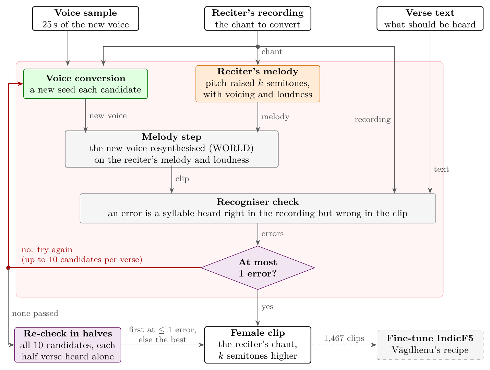

# Nandinī: a female voice for Vāgdhenu

Code for making a female Sanskrit chant voice for [Vāgdhenu](https://prathosh.in/vagdhenu/), with no recordings of a
female reciter. Vāgdhenu's released chant (1,467 clips, about 5.3 hours) is all in one male voice, and so is its model.
Nandinī is made in two parts:

1. **The dataset:** each of Vāgdhenu's clips is converted into a female voice, and his melody is put back, so every
   clip keeps his chant (text, timing and tune) in the new voice.
2. **The voice:** IndicF5 is fine-tuned on those clips with Vāgdhenu's own recipe, and the two other parts his renderer
   needs, the reference bank and the vocoder, are remade for the new voice. The result runs in Vāgdhenu's renderer
   unchanged.

**[Paper](https://www.alphaxiv.org/abs/2611.nandini-sanskrit-chant-synthesis)** ·
**[Website](https://ram-g-athreya.github.io/nandini/)** ·
**[Model](https://huggingface.co/ramgathreya/nandini)** ·
**[Dataset](https://huggingface.co/datasets/ramgathreya/nandini-data)**

## Setup

Install [uv](https://docs.astral.sh/uv/) and run every command from this folder. Set up only what you need:

| To                                                     | Run                                  |
| :----------------------------------------------------- | :----------------------------------- |
| chant with the released model in PyTorch               | `scripts/setup_pytorch.sh`           |
| chant with the released model in ONNX, without PyTorch | `scripts/setup_onnx.sh`              |
| chant with the released model on Apple silicon (MLX)   | `scripts/setup_mlx.sh`               |
| make the dataset                                       | `scripts/setup_seed_vc.sh`           |
| train the voice and the vocoder                        | `scripts/setup_pytorch.sh --vocoder` |

Each script makes one environment under `external/` and fetches the outside code it needs (Vāgdhenu's, Seed-VC,
BigVGAN) at the commits pinned in `nandini/config.py`; none of it is copied into this repo. Models and data download
from Hugging Face on first use. Training starts from the IndicF5 base model, which is gated: accept its terms on
[its model page](https://huggingface.co/ai4bharat/IndicF5) and log in.

## Use the released model

The trained voice is on Hugging Face: [`ramgathreya/nandini`](https://huggingface.co/ramgathreya/nandini) holds the
model, the vocoder, the female reference bank, `vocab.txt`, and the ONNX files. The dataset it was trained on is
[`ramgathreya/nandini-data`](https://huggingface.co/datasets/ramgathreya/nandini-data).

```bash
uv run nandini chant --text "वसुदेवसुतं देवं कंसचाणूरमर्दनम् । देवकीपरमानन्दं कृष्णं वन्दे जगद्गुरुम् ॥" --out out.wav
uv run nandini chant --backend onnx --text "..."             # without PyTorch; --compact for the smaller files
uv run nandini chant --backend mlx --text "..."              # Apple silicon GPUs
```

- **First use** downloads the model into `nandini-model/` (and converts it once for MLX).
- **Rendering** goes through Vāgdhenu's own renderer, with his text handling (Kannada routing, meter detection, pādas)
  and Nandinī's voice, vocoder and reference bank. `--meter` overrides the detected meter; `--seed` defaults to 60, as
  on his website.
- **Speed** for a 10 s verse on a MacBook Air M2: about 1 minute with MLX, 3 minutes with PyTorch on MPS, 6 to 10
  minutes with ONNX on the CPU.
- **The compact ONNX files** (344 MB) are an approximation of the full set: their renders differ from it about as much
  as another seed's do.
- **From Python:** `nandini/chant.py` shows the renderer calls for each backend.
- **In the browser:** `demo/` has a website and a Gradio app that chants in Nandinī's voice beside Vāgdhenu's.

## Making the dataset



```bash
nandini generate             # every verse -> out/
nandini recheck-halves       # the verses that missed, re-checked with each half verse transcribed alone
```

- **Per verse:** up to 10 candidates. Each converts Vāgdhenu's recording to the voice of `voice/female_voice_sample.wav`
  (seed 1000 · j + the verse's index), then puts his melody back with WORLD, raised k semitones. The first candidate
  that [Su-śrotā](https://huggingface.co/prathoshap/sushrota-sanskrit-asr) hears with at most 1 syllable wrong is kept,
  else the one with the fewest errors.
- **Options:** `--part i/P` splits the run into parallel parts, `--indices a,b` runs a subset, and a stopped run
  restarts where it left off. `--dataset-dir DIR` reads a local copy of Vāgdhenu's recordings.
- **Outputs:** `out/final/` (the kept clips), `out/kept_rechecked.csv` (the kept list), `out/attempts_part*.csv` (every
  candidate), `out/settings_part*.json`.
- **As released:** one A40, 4 parts, about 19 hours; 1,298 of 1,467 verses at most 1 syllable wrong. The kept list is
  `manifests/released_kept.csv`: conversions differ slightly between machines, so pass `--kept` with it to train on
  exactly the released choice.

To check a run:

```bash
nandini mark                 # Su-śrotā on both recordings of every kept verse -> out/marks/
nandini tables               # -> out/tables/: transcripts, per-syllable and substitution tables
nandini report               # -> out/report/: report.md and charts
nandini listen build         # -> out/listen/index.html
nandini listen serve         # then open http://localhost:8765/listen/
```

The listening page plays Vāgdhenu's recording and Nandinī's clip for every verse, with the text and the syllables
Su-śrotā got wrong. `--run` points these commands at a downloaded copy of the released dataset.

## Training

Vāgdhenu's training script and settings, unchanged, to his length (EMA weights at step 14,800). The commands re-run
themselves in the PyTorch environment; `train` needs NVIDIA GPUs.

```bash
nandini training-data        # out/ -> training/dataset/ (add --kept manifests/released_kept.csv for the released choice)
nandini warm-start           # training/warm.pt from the IndicF5 base
nandini train                # training/run/: stops after step 14,800; EMA weights every 2,000 steps
nandini female-bank          # training/female_bank/: one reference clip per meter, in the new voice
```

Checks after training:

```bash
nandini speech-check render --ema training/run/ema/ema_14800.pt
nandini speech-check score
nandini trend-check render --ema training/run/ema/ema_12000.pt training/run/ema/ema_14800.pt
nandini trend-check score
```

**The vocoder:** Vāgdhenu's BigVGAN, fine-tuned again on these clips with NVIDIA's `train.py`, unchanged
(`scripts/setup_pytorch.sh --vocoder` installs what it needs):

```bash
nandini vocoder data         # IndicF5 mels of the training clips
nandini trend-check render --ema training/run/ema/ema_14800.pt --verses V.csv --save-mel --out M   # mels to monitor
nandini vocoder train &
nandini vocoder monitor --mels M
```

Run `train` and `monitor` together. Every 2,500 steps the monitor measures echo and shiver, and once they level
off it stops training and averages the last 6 checkpoints into the final vocoder.

As released: 2 × RTX A6000, 216 minutes for the model; 2 × A40 for the vocoder.

## Making the ONNX version

In the PyTorch environment, with onnx and onnxruntime added:

```bash
uv pip install --python external/train-env/bin/python onnx==1.23.2 onnxruntime==1.23.2
nandini onnx make --ema training/run/ema/ema_14800.pt --vocoder training/vocoder/run/vocoder.pt   # -> training/onnx/
nandini onnx small --ema training/run/ema/ema_14800.pt    # the compact files, with weights stored as int8
nandini onnx check verses --ema ... --vocoder ... --bank training/female_bank
nandini onnx check score
```

## Tests

```bash
uv sync --group test && uv run pytest      # about 6 s, offline, no models
```

## Repository layout

| Path           | What it is                                                                                                                  |
| :------------- | :-------------------------------------------------------------------------------------------------------------------------- |
| `nandini/`     | the code: one command, `nandini`, with every setting the release used in `nandini/config.py` (`nandini config` prints them) |
| `manifests/`   | clip lists, the released kept list, the 60 test verses                                                                      |
| `voice/`       | the 25 s sample that sets the female voice                                                                                  |
| `demo/`        | the website and the live demo (a Gradio app for a Hugging Face Space)                                                       |
| `scripts/`     | one setup script per environment                                                                                            |
| `third_party/` | pinned requirements for each environment, and a Seed-VC patch for Apple silicon                                             |
| `tests/`       | quick offline checks (`pytest`)                                                                                             |
| `docs/`        | the dataset diagram                                                                                                         |
| `external/`    | not in the repo: outside code fetched by `nandini fetch`, and the environments                                              |

## Licences

The code is licensed under the [Apache License 2.0](LICENSE): use it, change it, build on it and sell what you make,
as long as you keep the licence and the [NOTICE](NOTICE) file and say what you changed.

Some parts carry their own terms (details in [NOTICE](NOTICE)):

- **`voice/female_voice_sample.wav`** is output of [Indic-Speak](https://huggingface.co/bodhan-ai/indic-speak)
  (revision `76e0814`, speaker Bharati) and is
  under the Bodhan AI Open Model License: keep its credit, and its acceptable-use restrictions apply to whatever you
  make with it.
- **`third_party/seed-vc-mps-float32.patch`** modifies Seed-VC and is GPL-3.0.
- **Audio made with this code** is derived from the Vāgdhenu dataset (CC-BY-4.0): credit Vāgdhenu and its authors.
- **`manifests/test_verses*`** are texts from the Digital Corpus of Sanskrit (Oliver Hellwig), CC BY 4.0: credit the
  DCS.
- **The models the code downloads** keep their own licences: IndicVoiceChanger and Seed-VC (GPL-3.0; Seed-VC runs as
  a separate program and is not included), SpeechBrain's ECAPA model (Apache-2.0), and Su-śrotā (no licence stated
  on its model card).

## Citation

If you use Nandinī, please cite the paper:

> Ram G Athreya. _Nandinī: A Female Voice for Vāgdhenu, a Vṛtta (Meter) Aware Śloka-to-Chant (TTS) System for
> Sanskrit._ alphaXiv, 2026. <https://www.alphaxiv.org/abs/2611.nandini-sanskrit-chant-synthesis>

```bibtex
@misc{athreya2026nandini,
  title     = {Nandin{\={i}}: A Female Voice for V{\={a}}gdhenu, a V{\d{r}}tta (Meter) Aware
               {\'{S}}loka-to-Chant (TTS) System for Sanskrit},
  author    = {Ram G Athreya},
  year      = {2026},
  publisher = {alphaXiv},
  url       = {https://www.alphaxiv.org/abs/2611.nandini-sanskrit-chant-synthesis}
}
```

Nandinī is built on Vāgdhenu's data, recipe and renderer, so please cite Vāgdhenu too:

> A. P. Prathosh. _Vāgdhenu: A Vṛtta (Meter) Aware Śloka-to-Chant (TTS) System for Sanskrit._ arXiv:2608.26146, 2026.

```bibtex
@misc{prathosh2026vagdhenu,
  title         = {V{\={a}}gdhenu: A V{\d{r}}tta (Meter) Aware {\'{S}}loka-to-Chant ({TTS}) System for {S}anskrit},
  author        = {Prathosh, A. P.},
  year          = {2026},
  eprint        = {2608.26146},
  archivePrefix = {arXiv}
}
```
